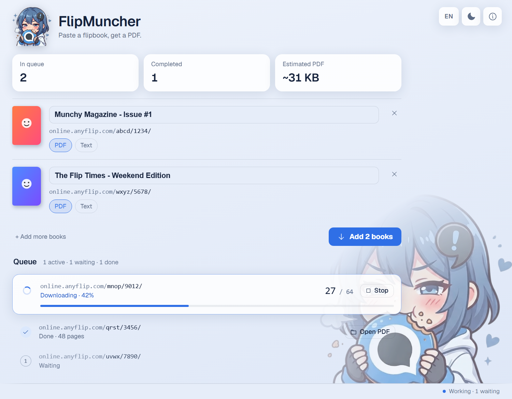

<p align="center">
  
</p>

<h1 align="center">FlipMuncher</h1>

<p align="center">
  <em>Paste an AnyFlip link. Get a PDF, the book's text, or both.</em>
</p>

<p align="center">
  <a href="https://buymeacoffee.com/matthewuwu"></a>
  <a href="https://github.com/Matthewuwu/FlipMuncher/releases/latest"></a>
</p>

<p align="center">
  <a href="#-download">Download</a> ·
  <a href="#-features">Features</a> ·
  <a href="#-languages">Languages</a> ·
  <a href="#-building-from-source">Building</a> ·
  <a href="#-support">Support</a> ·
  <a href="#-license">License</a>
</p>

<p align="center">
  
  
  
  
  <a href="https://github.com/Matthewuwu/FlipMuncher/releases/latest"></a>
  <a href="LICENSE"></a>
</p>

<p align="center">
  <picture>
    <source media="(prefers-color-scheme: dark)" srcset="docs/screenshot-dark.png">
    
  </picture>
</p>

FlipMuncher is a small desktop app that downloads books from [AnyFlip](https://www.anyflip.com/)
and turns them into a PDF, plain text (OCR), or both. Every link gets a live preview of its
cover and title before you commit to downloading, and an estimated PDF size so there are no
surprises. No installer and no account.

Built with Go and [Wails](https://wails.io/); the interface is plain HTML, CSS and JS with no bundler.

## ✨ Features

**Add books**

- Paste one or more AnyFlip links, one per line. Each shows its cover, title and page count
  before it joins the queue.
- Edit the title inline if you want a different filename than the one AnyFlip uses.
- Choose PDF, extracted text (OCR), or both, per book.

**Download**

- Books download one at a time, in the order you add them. Watch live progress, stop the
  current one, and open the finished file's folder straight from the queue.
- **Estimated PDF size** in *Advanced*: the first page is re-encoded in the app to measure real
  bytes at the chosen quality, then scaled to the whole book. Three presets (Smallest,
  Recommended, Sharpest) show the size of each before you start.
- Optional JPEG compression (quality 60 by default), keep or discard the page images, and
  tune threads, retries, retry delay and chunk size.

**Interface**

- "Glass" theme: frosted panels over a soft blue wash, with the mascot anchored behind the UI.
  Light by default, dark with one click; your choice is remembered.
- Stat cards at the top: books in queue, completed, and the estimated PDF size.
- 6 languages with a selector in the header; follows your system language on first run.
- Keyboard friendly: <kbd>Ctrl</kbd>+<kbd>Enter</kbd> opens or closes *Advanced* from anywhere,
  dialogs trap focus and restore it, and status changes are announced to screen readers.
- Fonts are bundled, so the interface looks the same offline.

## 🌍 Languages

English is the base language **and** the fallback, so a missing translation never leaves blank text.
On first run FlipMuncher follows your system language and falls back to English; a manual choice
is remembered across launches.

| Language | Code | Language | Code |
| --- | --- | --- | --- |
| English | `en` | Français | `fr` |
| Italiano | `it` | Deutsch | `de` |
| Español | `es` | Português | `pt` |

Strings live in [`frontend/dist/i18n.js`](frontend/dist/i18n.js). To add a language, copy the `en`
block, translate the values (keep the `{placeholders}`) and add the code to `LANGS`.
The text extracted by OCR is English only.

## 📦 Download

Grab the latest build from [Releases](https://github.com/Matthewuwu/FlipMuncher/releases/latest).

- **Windows**: two portable `.zip` files — unpack anywhere and run
  `FlipMuncher.exe`, no installer needed.
  - `FlipMuncher-portable.zip` (about 290 MB) bundles its own WebView2
    runtime, so it works on any Windows 10 or 11 machine, even offline.
  - `FlipMuncher-windows-lite.zip` (about 44 MB) uses the WebView2 already
    installed on your system. Windows 11 and up-to-date Windows 10 include
    it; if it's missing, install the
    [Evergreen WebView2 Runtime](https://developer.microsoft.com/microsoft-edge/webview2/)
    from Microsoft. OCR is bundled in both.
- **Linux**: either `FlipMuncher-x86_64.AppImage` (make it executable and
  run it) or `FlipMuncher-linux-portable.tar.gz` (unpack and run
  `FlipMuncher`). Both need GTK3 and WebKitGTK installed system-wide
  (already present on most desktop distros; otherwise install your
  distro's `webkit2gtk` package) — unlike Windows' WebView2, these can't
  be bundled portably. Linux builds are made on Ubuntu 24.04 and need
  glibc 2.39 or newer (Ubuntu 24.04+, Debian 13+, Fedora 40+ or similar);
  older distros won't run them.
- **macOS**: `FlipMuncher-macos.zip` — unzip and run `FlipMuncher.app`.
  It's only ad-hoc signed (not notarized), so Gatekeeper blocks the first
  launch. On macOS 15 and later right-click → Open no longer bypasses this:
  try to open the app once, then go to System Settings → Privacy & Security
  and click **Open Anyway**. Or remove the quarantine flag in Terminal:
  `xattr -dr com.apple.quarantine FlipMuncher.app`.
  Text extraction (OCR) is bundled for Apple Silicon only; on Intel Macs
  the PDF download works but OCR is unavailable.

## 🛠 Building from source

You need **Go 1.25** and the [Wails CLI](https://wails.io/docs/gettingstarted/installation)
(v2.16.0, the version the release workflow uses).

```bash
go install github.com/wailsapp/wails/v2/cmd/wails@v2.16.0
wails dev                                   # live development window
wails build -platform windows/amd64 -clean  # or darwin/universal, linux/amd64 -tags webkit2_41
go test ./...
```

Release packaging (bundled WebView2, Tesseract OCR, AppImage) lives in [`scripts/`](scripts) and
runs from [`.github/workflows/release.yml`](.github/workflows/release.yml) on every `v*` tag.

## 🗂 Project layout

```
main.go, app.go        Wails entry point and the methods the UI calls
internal/downloader/   AnyFlip fetching, PDF building, compression, OCR
frontend/dist/         the UI: index.html, style.css, app.js, i18n.js (no build step)
scripts/               per-platform release packaging
.githooks/pre-push     blocks pushes that contain personal data (see below)
```

## 🔐 Contributing safely

A pre-push hook stops a push that would publish personal data: commits with a non-noreply
e-mail, e-mail addresses or local user paths in added lines, and any pattern you list in
`.git/pii-patterns` (one regex per line, local only). Enable it once per clone:

```bash
git config core.hooksPath .githooks
```

## ⚖️ Responsible use

Only download content you have the right to download.

## ☕ Support

> [!TIP]
> If FlipMuncher saved you some time, you can
> [buy me a coffee](https://buymeacoffee.com/matthewuwu). Entirely
> optional — the app is free and stays free, see **License** below.

## 🙏 Credits

FlipMuncher is built on top of
[anyflip-downloader](https://github.com/Lofter1/anyflip-downloader) by
Lofter1, released under the GNU GPLv3. See `LICENSE-anyflip-downloader`
for its original license text.

## 📄 License

GNU General Public License v3.0 — see [`LICENSE`](LICENSE).
